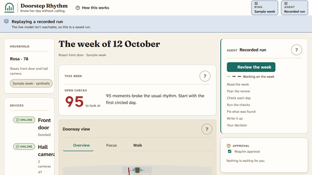
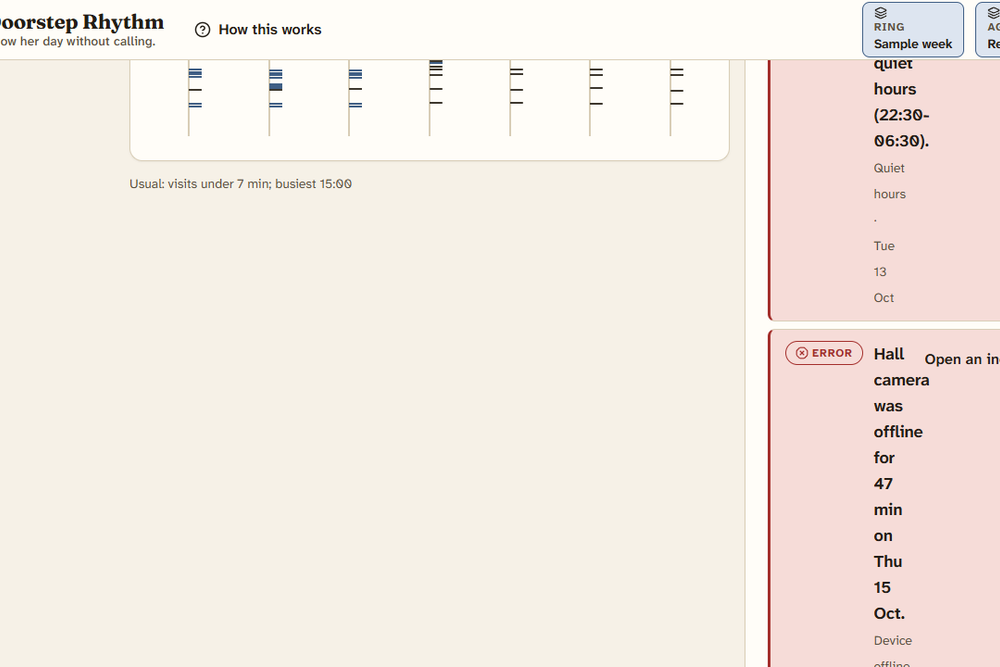
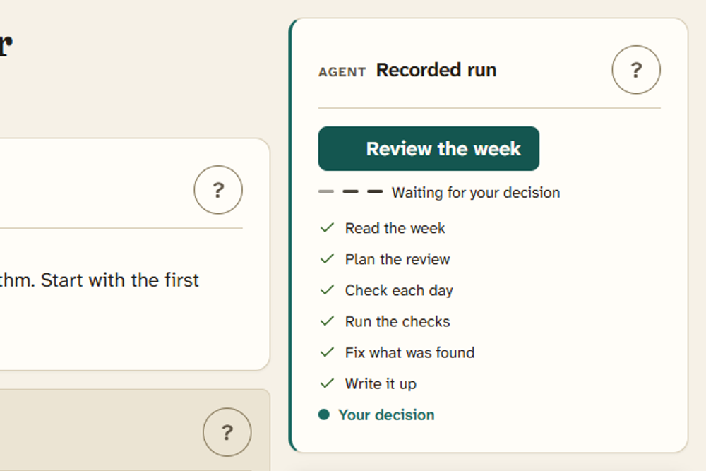
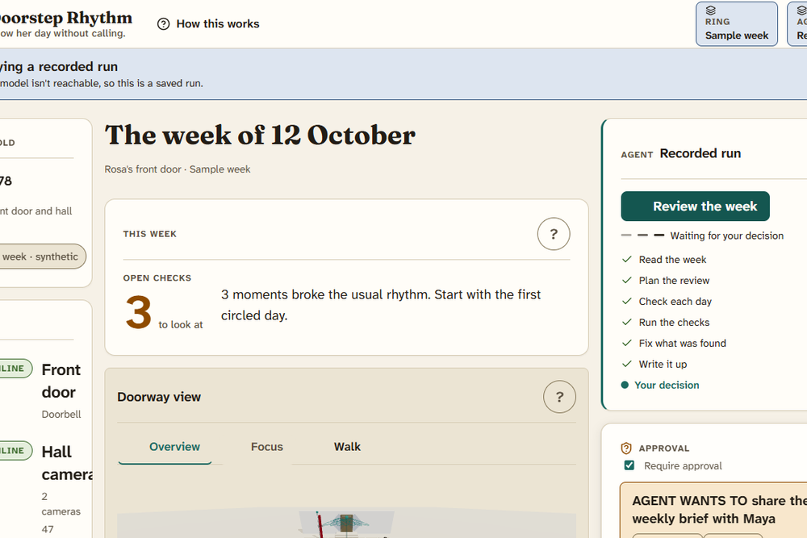
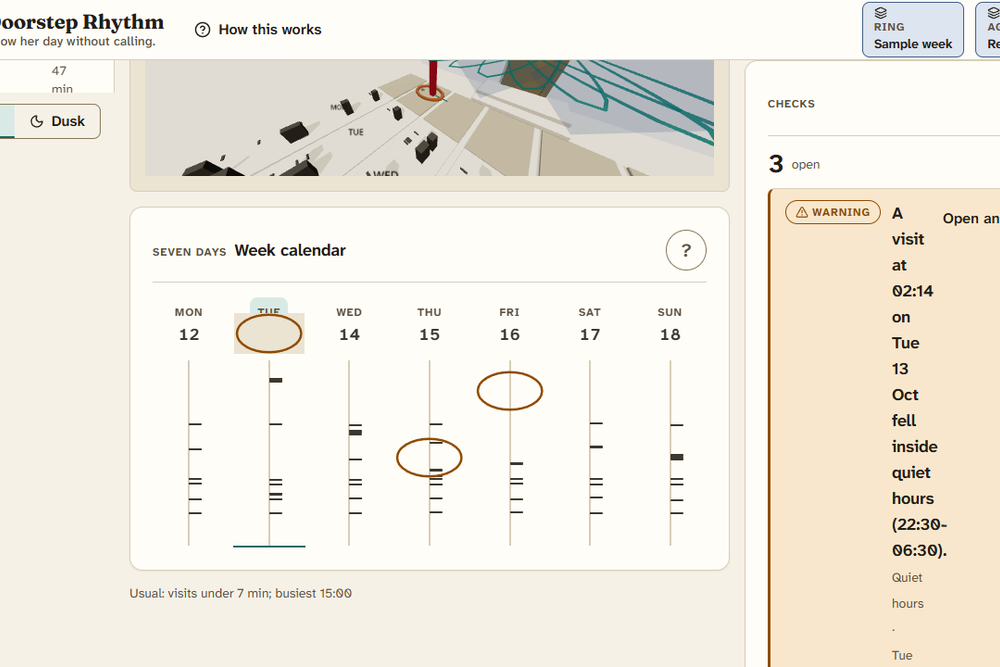
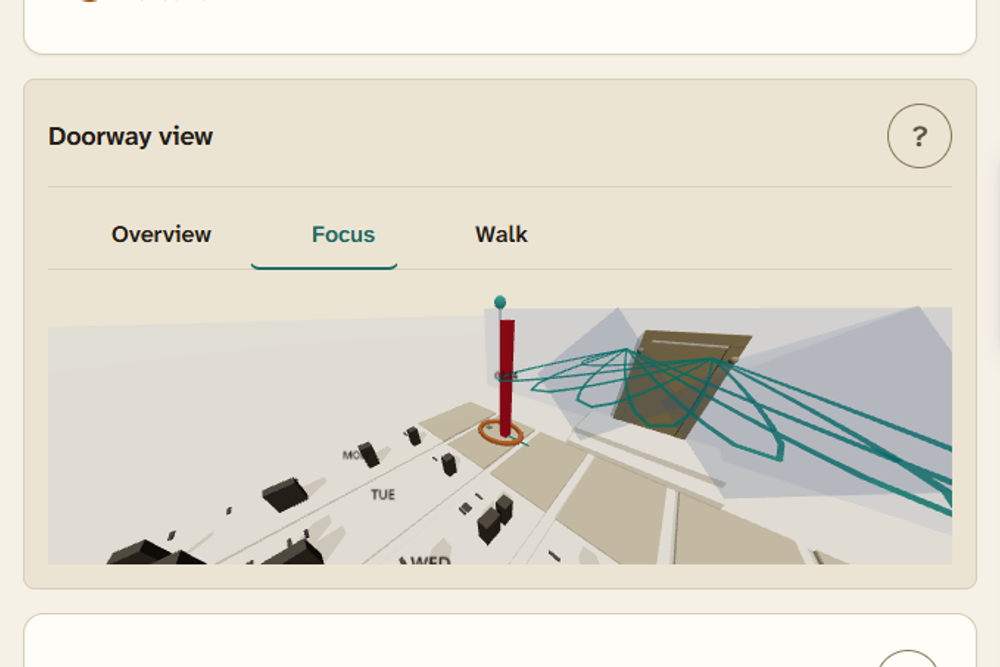
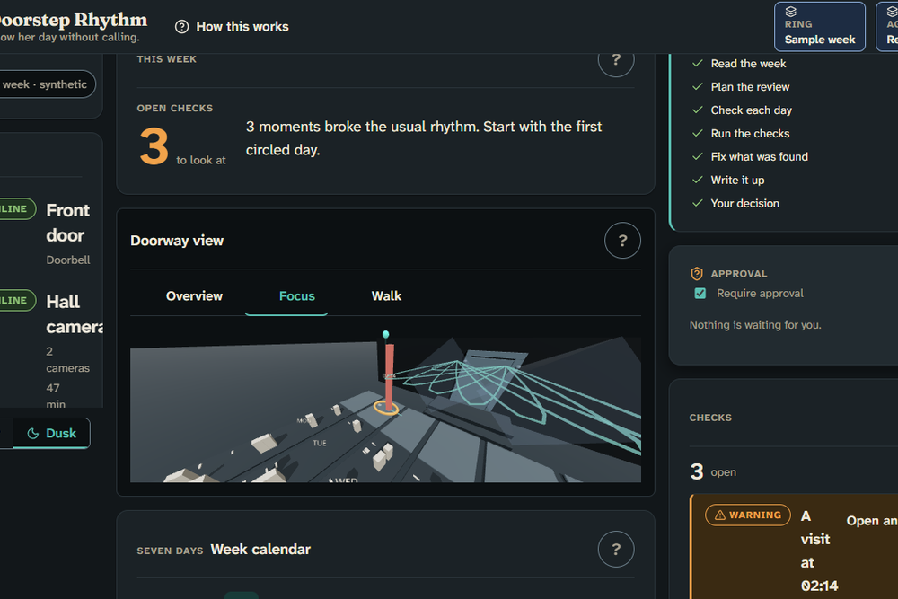

# Doorstep Rhythm

Know her day without calling. Doorstep Rhythm circles the one moment at her front door that did not fit the week.

## Live demo
https://doorstep-rhythm-7wndoy2fuq-uc.a.run.app

## Video
https://doorstep-rhythm-7wndoy2fuq-uc.a.run.app/watch

## See it

<sub>A recorded run of the product doing its job.</sub>

| Still | Still |
|---|---|
| <br><sub>Seven days of Rosa's front door drawn as a paper calendar with every visit marked.</sub> | <br><sub>The agent reads the week and checks each day while every step is listed as it happens.</sub> |
| <br><sub>Before anything reaches Marta the review waits for a person to press Approve or Reject.</sub> | <br><sub>The one moment that did not fit the routine is circled in pencil on its day.</sub> |
| <br><sub>The same week stands up in three dimensions with the circled moment framed.</sub> | <br><sub>The page has a calmer second look for the evening, switched with one control.</sub> |

## Try it in 2 minutes
1. Open the live page and press Load the sample week.
2. Press Review the week.
3. Press Approve when the request appears.
4. Press Focus above the 3D view.
5. Open /watch and press Watch the agent do it.

> Look through the week and put a note on the one moment that doesn't fit her usual routine.
> Check the week over, fix anything that doesn't add up, and tell me in two sentences how it looks.
> Please play a reassuring message through the door speaker so Mum knows someone is thinking of her.

## Why Ring is the point
Doorstep Rhythm reads the doorway through signed webhooks for motion, doorbell presses and device presence, fills the quiet stretches from event history polling, opens live video when a moment needs eyes, attaches snapshots as evidence, plays gentle chime messages, links the household account, and threads more than one camera into one visitor story. Without that event stream there is no lawful resident-consented record to interpret, and without week-over-week interpretation a threshold pages at night instead of saying what is normal for this house.

## What the agent can do
| Action | Group | What it does |
|---|---|---|
| `list_week_events` | read | Lists door events and the visits built from them for one day or the whole record, oldest to newest. |
| `get_incident` | read | Returns one incident with its notes and attached evidence (labels without image data). |
| `get_rhythm_baseline` | read | Returns the household's usual rhythm from the baseline week: the longest-stay figure (90th percentile, in minutes), the median stay, the number of visits it is based on, and the per-weekday-hour visit rhythm. |
| `list_devices` | read | Lists the household's Ring devices with their components and whether each can play audio, show live video or take a snapshot. |
| `get_device_status` | read | Reads a device's current status from Ring: online or offline, power source and battery level. |
| `get_device_capabilities` | read | Reads what a device, or one of its components, can do: motion detection, live video, snapshot and chime audio. |
| `ingest_ring_events` | change | Brings new events into the record, either the webhooks waiting in the inbox or a device's event history. |
| `merge_duplicate_events` | change | Folds events that are the same moment seen twice into the earliest one. |
| `reconcile_webhook_gap` | change | Fills the gap left when a device's webhooks went quiet by reading its event history from the last webhook onward, skipping events already in the record. |
| `open_incident` | change | Opens an incident for something that stood out and, by default, attaches a snapshot from the device as evidence. |
| `set_incident_status` | change | Moves an incident to a new status and, when given, stores the explanation the family will read. |
| `check_week_model` | verify | Runs every rule over the record and returns the issues with a suggested fix for each, plus the error and warning counts. |
| `compare_to_baseline` | verify | Compares one day with the household's baseline and returns the visit count, the longest stay against the usual figure, quiet-hours visits, routines kept and missed. |
| `focus_day` | navigate | Moves the view to one day so the person watching sees what you are reading. |
| `focus_incident` | navigate | Selects an incident in the view, moves to its day and frames it in the 3D scene. |
| `set_camera_shot` | navigate | Chooses the camera shot of the 3D doorway view: the whole week, a walk along a visitor's path, or a close frame on one incident. |
| `add_incident_note` | collaborate | Adds a short note to an incident so the family can see what you saw. |
| `propose_family_nudge` | collaborate | Prepares one gentle message for the family member to send, shown as a decision card. |
| `play_chime_announcement` | cross_boundary | Plays a short chime on the front-door device so someone at home hears a gentle sound. |
| `export_weekly_brief` | cross_boundary | Builds the weekly brief from the record and shares it with the family. |

Every destructive step pauses behind the approval bar until a person presses Approve or Reject, and granting consent to a contact channel remains a person's job — the agent asking for it gets a refusal that tells it what to do instead.

## The truth engine
The record is checked against quiet hours, long visits, device offline stretches, consent scopes, duplicate events, change history and moments without a write-up. The agent reads the findings, repairs what they point at, and re-checks until no errors remain. A rejection at the approval bar sends the run back with the human's words attached. Nothing reaches the family still carrying an open error. The count beside the checks is the same number the engine reports.

## Measured proof
<!-- hee-eval:start -->
### Measured agent success

95.0% task success (19/20) with the product's action surface against 35.0% (7/20) with generic screen actions; 44527.3 tokens and 34.2 s per try with the surface.

| Condition | Runs | Passed | Success | Calls valid straight away | Failed calls | Retries | Tokens per run | Seconds per run |
|---|---|---|---|---|---|---|---|---|
| With the product's action surface | 20 | 19 | 95.0% | all | 405 | 397 | 44527.3 | 34.2 |
| Generic screen actions | 20 | 7 | 35.0% | nearly all | 43 | 37 | 60192.6 | 17.7 |


Measured on 10 frozen tasks, 2 repetitions each, with gemini-2.5-flash; this shows success on those tasks only.

Method: ten tasks written in the user's own words and frozen before tuning (hash `634a2c44`); each run 2 times per condition with the same model; outcomes are graded from the final application state. Several iterations, each changing one aspect of the action surface; an iteration was kept when success improved without more safety failures. Reproduce: `npx vite-node hee/src/agent-eval/cli.ts run --entry . --arms both`.
<!-- hee-eval:end -->


## Evidence
- [Architecture with runtime proof lines](architecture.json)
- [Browser test results](design_documents/e2e-testing/results.md)
- [Stills with one-sentence captions](shots/showcase/captions.json)
- [Measured action-surface evaluation](evals/report.json)

## Architecture
```
+-------------+     +----------------+     +---------------+
| Family view | --> |   Run server   | --> |   Ring API    |
| (browser)   | <-- | (Cloud Run)    | <-- | (devices)     |
+-------------+     +----------------+     +---------------+
      |                    |                       |
      v                    v                       v
+-------------+     +----------------+     +---------------+
| Truth eng.  |     | Webhook inbox  |     | Amazon Bedrock|
| (browser)   |     | (server)       |     | (agent roles) |
+-------------+     +----------------+     +---------------+
                    |                       |
                    v                       v
             +----------------+     +---------------+
             | Recorded run   |     | Cost guard    |
             | (golden cache) |     | (sidecar)     |
             +----------------+     +---------------+
```

## What building this taught us about Ring
The documentation shows one webhook shape, but the organizer's sample sends a flat event_type and device_id pair with no request envelope, so the tolerant normalizer reads both and the strict contract test pins exactly where they differ. History items arrive with wire values like motion dot human and ding that are not domain event types, so the port translates them on the way in and the mock server translates them back, which keeps the round trip exact. Clips are capped at half a minute while the committed contract once asked for a full minute, so snapshot evidence ships on every incident and clips stay inside the bound the plan allows.

## Develop, test, deploy
```
npm install
```
```
npm run build
```
```
npm run server
```
```
npm run e2e
```
```
BASE_URL=<url> npx playwright test e2e/smoke.spec.ts
```
```
npm run deploy:cloud-run
```

## Licence and credits
MIT. Upstream credits: hee chassis (hee/VENDOR.json); kit pinned dependencies (src/kits/agent-workflow/UPSTREAM-NOTICE.md, src/kits/three-scene/UPSTREAM-NOTICE.md); showcase-replay is original work with no upstream (src/kits/showcase-replay/UPSTREAM-NOTICE.md). Built with the Ring API and Amazon Bedrock (Strands Agents SDK) for the AWS Builder mini-challenge, with a labelled fallback when Bedrock is unreachable.
