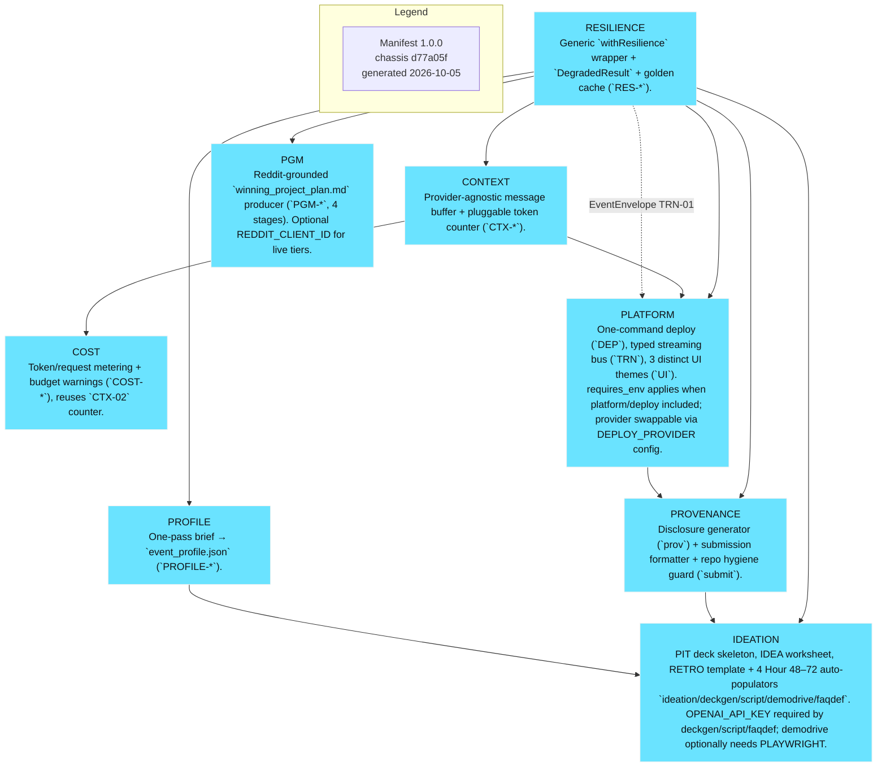
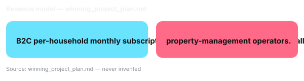

# Title / Tagline

Know her day without calling.

> Requirement IDs: PIT-01, PIT-REU-01

<!-- SLOT 01 -->
**Doorstep Rhythm — a caretaking companion for the solo-living doorway**
<!-- /SLOT 01 -->

---

# Problem

> Requirement IDs: PIT-01, PIT-REU-01

<!-- SLOT 02 -->
## Problem

- Grounded evidence from r/AgingParents (2026-08): an adult child describes fiercely independent 80-something parents where mum declines fast while dad denies anything changed — from a distance, nobody can distinguish a slow day from an emergency, and the workaround (daily surveillance-style phone calls) erodes the parent's autonomy while still missing silent crises.
- A second record (r/AgingParents, 2026-09) shows the early-signal problem: a senior with mobility loss leaves small dropped items lying around because picking them up is no longer possible — decline announces itself in tiny ambient signals long before anyone calls for help.
- Severity: missed days convert directly into late-discovered falls and hospitalizations; workaround cost is daily anxious calling plus periodic emergency trips.
- Evidence: r/AgingParents, 2026-08
<!-- /SLOT 02 -->

---

# Specific User / Who Feels This Pain

> Requirement IDs: PIT-01, PIT-REU-01

<!-- SLOT 03 -->
## Specific User

- Specific user: A long-distance daughter (40s–50s) whose mother (80s) lives alone and refuses anything that smells like surveillance — grounded in r/AgingParents records from 2026-08 and 2026-09 showing independent parents, denied decline, and ambient early signals.
- Why now: Could this have been built 2y ago with forms+DB and no AI?
<!-- /SLOT 03 -->

---

# Live Demo

> Requirement IDs: PIT-01, PIT-REU-01

<!-- SLOT 04 -->
▶ LIVE DEMO — moving capture (see SCRIPT)

- Assembled UI screens: Landing, Dashboard, Listing Browse, Item Detail, Checkout, Deploy Status
> **Demo:** Open https://doorstep-rhythm-7wndoy2fuq-uc.a.run.app — the review runs there with no sign-in.
<!-- /SLOT 04 -->

---

# Architecture / Tech Overview

> Requirement IDs: PIT-01, PIT-REU-01

<!-- SLOT 05 -->
The engine layer is a backend service (server-to-server only, per Ring CORS rules) with a webhook receiver, an Event History reconciler, a Bedrock/Strands sort agent operating the visit/incident store through the 18 typed actions, a deterministic truth engine consulted after every act batch, a web timeline UI plus the signature 3D doorway view, and a DEMODRIVE-captured golden path with mock-envelope replay for offline survival. Agent/LLM responsibilities: extractor types events, planner proposes sort, actor mutates only through store actions, narrator explains; validity, arithmetic, quiet-hours math and consent all live in code. Prompt boundaries: one full prompt per model role, JSON-schema-validated outputs, one retry with validation errors, then visible degradation. Corpus: the brief's capability map plus Ring API docs; no RAG corpus needed beyond docs. UI states: live timeline, incident focus, approval bar, 3D overview/focus shots, degraded banner. Deploy proof: localhost runnable plus an optional public URL; the video shows the Playground-token run against simulator events, satisfying the platform proof rule.

### Truth Engine

Pure functions over the week model producing Issue[] with id, severity, entity ids, human message with units, and suggested fix action. Rules: quiet-hours violation (events during 22:00–07:00 local ±30 min tolerance); dwell anomaly (linger >15 min vs personal baseline p90); outage vs quiet (device_offline >30 min escalates, else informational); consent scope (unapproved contact methods blocked); duplicate suppression (same request_id or ±60 s same-type bursts merged). The agent calls check_week_model after every act batch and repairs what it reports; the human sees a Check panel with a count badge. The demo's deliberate error: a seeded duplicate motion burst that the engine merges while the agent narrates the repair.

### Demo Inputs

- Live Ring Developer Playground events (motion_detected with human sub-type, button_press, device_online/offline) via short-lived Playground token — source: operator's own Playground session at https://developer.amazon.com/ring/console/playground; terms: personal testing token, ~30 min life, regenerated live; the judge can generate their own token the same way.
- Bundled anonymized 14-day doorstep event set (JSON) — source: synthesized from the shape of real Playground payloads for deterministic replay; licence: created for this entry, MIT, labelled synthetic in UI and README because no real senior's doorway data may ship.
- Seeded duplicate-burst error case — source: same bundle; used only for the verify → repair beat.

### Mandated Technology Leverage Map

| Capability | Tier | Used for (product reason) | Visible where (screen / feed / video beat) |
|---|---|---|---|
| Webhook motion_detected + sub_type human | core | primary rhythm signal | timeline pulses / 0:20 beat |
| button_press | core | visit/check-in affordance | incident cards / 0:45 beat |
| device_online/offline webhooks | advanced | outage-vs-quiet truth rule | health strip / 1:10 beat |
| HMAC-SHA256 webhook verify + idempotency | core | tamper-proof ingest | feed badge per event / code walk |
| Event History polling failover | advanced | gap-night coverage | seam-stitched ribbon / 1:30 beat |
| Device discovery + status + capabilities | core | capability gating + health | setup screen / code walk |
| WHEP live session start/stop | core | on-demand visual check | video panel / 1:50 beat |
| Image snapshot download | advanced | low-bandwidth sort | incident thumbnails |
| component_id multi-camera | frontier | visitor threads across cameras | 3D arcs / 2:00 beat |
| Chime audio playback | frontier | gentle reassurance actuator | checkpoint-gated play / 2:10 beat |
| One-way account linking + staging users | advanced | lawful consent + test parity | consent screen |
| Ring Appstore MCP + Playground token | core | build velocity + day-0 run | README + 0:00 beat |

Coverage: 12/14 product-relevant (86%) — advanced: 4, frontier/open-question: 2. Beyond the sample: the organizer's sample streams one camera and echoes webhooks, while this entry fuses multi-camera threads, learns household rhythm, and gates caring actuators behind a truth engine and human checkpoints.

### Signature 3D Experience

- **Subject:** the household doorway week — stoop geometry, camera frustums, and event pillars on a time axis (spatial + time-series height-field treatment).
- **Why 3D:** the schedule of doorstep life is spatial — a flat log cannot show where visitors lingered and for how long.
- **Live binding:** webhook arrivals raise pillars and pulse frustums; sort recolors them; approve/reject animates the chime/notify action; selection syncs both ways with the 2D timeline and feed.
- **Stack:** three.js via @react-three/fiber + drei (OrbitControls, Environment) + postprocessing (SSAO/Bloom); instanced pillars; no new brand colors beyond the UI token set.
- **Shots:** overview, focus:event, walk (eye-level stoop), with 600–1200 ms eased transitions exposed on window.__demo3d.
- **Hero frame:** a dusk-lit stoop with one amber unknown-linger pillar pulsing while the agent's reasoning badge rests beside it.

### Hackathon Requirements & Compliance Matrix

| Requirement | Brief Verbatim | How This Plan Satisfies It | Judging Axis Evidenced |
|---|---|---|---|
| Mandatory Technologies | Ring APIs/SDKs/simulators/devices; repo must import and actually call them | Backend imports Ring REST, verifies webhooks, opens WHEP sessions; AWS Bedrock via Strands called for sort | Tech Implementation |
| Prize Tracks | Ring 1st $12,000 / 2nd $8,000; AWS Builder $5,000 + $5K credits | Primary Ring, secondary AWS Builder with documented integration | Quality of the Idea |
| Judging Axes + Weights | Tech Implementation, Design, Potential Impact, Quality of the Idea, equally weighted | Axis strategy per section; friction-log bonus pursued | All four |
| Submission Gate | Text description; GitHub repo; <3-min video; product feedback; track selection; pre-existing delta; optional feature requests + friction logs; testing access | Public GitHub repo with run instructions; Playground-token video <3 min; feedback + friction logs drafted from day 1 | Presentation via video |
| Rules | New or significantly updated; original work; IP stays with entrant; English; no post-deadline edits | Fresh repo, window-spread commits, PROVO disclosure of chassis reuse + AI assistance | Eligibility |

### Sponsored Track Strategy (1–2 tracks)

Focus: 2 tracks — Ring plus AWS Builder, justified because the Bedrock sort that carries the product's intelligence simultaneously satisfies the AWS Builder documented-integration rule on the same codebase, so the second track costs writing time only and doubles reachable prize. Ring: highest win-probability fit because caretaking monitoring plus accessibility aid plus event-based triggers are the rules' named creative categories; the imported-and-called surface is the Amazon Vision REST API (devices, status, capabilities, history, WHEP sessions) with HMAC-verified webhooks; the demo makes Ring the co-star with live event overlays and a status indicator on screen. AWS Builder: Bedrock (via Strands SDK) powers every sort call with the integration documented in the feedback answer; the demo's agent-reasoning badges name Bedrock on each call. Open Source is deliberately not a focus: a small upstream helper may ship, but chasing it would dilute rehearsal.

Bonus/Submission Gate: repo public on GitHub with license, setup/run instructions and Playground-token flow; video under 3 minutes opening on the working timeline; product feedback per SDK plus friction-log entries filed from day 1 for the bonus; testing access via locally runnable repo; no bonus integration beyond the two focus tracks — no bonus-chasing dilution.

Module emphasis (advisory): Consider the platform layer for the timeline UI, typed event-streaming bus and one-command deploy helper, because the judges must see live state and a public URL strengthens the Design axis. Consider the context buffer for the multi-week household model that must stay inside model context during long sort runs. Consider the cost guardrail because every sort call is metered and a runaway loop must never burn the demo budget. Consider the resilience wrapper for every Ring and Bedrock call with golden-cache replay, because the demo must survive venue Wi-Fi via the degraded ladder. Consider media/vision only if frame understanding joins the demo, since snapshots alone need no model. Consider provenance and ideation tooling for disclosure, deck, script, golden capture and Q&A, because packaging is judged. Suggest nothing else: the product's depth lives in its own visit model, truth engine, agent workflow and 3D doorway, not in chassis plumbing.

<!-- /SLOT 05 -->

---

# Business Value

> Requirement IDs: PIT-01, PIT-REU-01

<!-- SLOT 06 -->
## Business Value

- Specific user: Long-distance adult children of solo-living seniors in Ring-camera households.
- TAM: estimate — validate during build (anchor: Ring installed base plus home-care monitoring spend; no invented figure carried).
- Revenue model: B2C per-household monthly subscription plus B2B per-door licensing to small assisted-living and property-management operators.
- Why AI: Only an agent holding cross-week state can separate rhythm from anomaly and explain it kindly; thresholds page at 3am, humans burn out, and no static rule knows that Mrs. Alvarez never answers the door before her Thursday program ends.

<!-- /SLOT 06 -->

---

# Ask / Next Steps

> Requirement IDs: PIT-01, PIT-REU-01

<!-- SLOT 07 -->
**Ask.** Open https://doorstep-rhythm-7wndoy2fuq-uc.a.run.app, press Load the sample week, then Review the week.
**Team.** The people who built Doorstep Rhythm are listed on the Devpost submission.

- Sponsor tracks (from frontmatter): Ring, AWS Builder
<!-- /SLOT 07 -->

---

# Disclosure & Provenance

> Requirement IDs: PIT-03, PROV-01, PIT-REU-01

<!--
PIT-03 - Fixed slot. Do not delete or move.
Source: PROV-01 disclosure_text (master_blueprint.md §4 #8).
Writer: PROV-01 (DP-J). Populator: DECKGEN-02 (M13) verbatim - never hand-authored here.
-->

<!-- PROV-01:BEGIN -->
# Provenance & Disclosure

> Generated from the assembly manifest — do not hand-edit accuracy; polish wording only if needed.

## Reused prior code

For this hackathon I reused **4** pre-existing block(s) of code that handle infrastructure-level functionality, none of them specific to this project:

- a message buffer that keeps a conversation inside a model's context window, with a pluggable token counter
- code that counts token and request usage and warns before a configured budget is exceeded, to prevent overspending
- a typed event-streaming bus for pushing step-by-step progress to the browser, plus a one-command deploy helper and a small themed UI shell
- a wrapper that retries a slow or failed provider call and falls back to a cached response, so a live demo never dead-ends on a blank screen

Thus all application-level code, and most other low-level code, was designed and implemented only for this hackathon.

The repository also contains a small amount of pre-existing developer tooling used to prepare this submission's documents. The application does not call it at runtime and it is not part of the product.

## How this entry was built

The workflow was: design plans authored with Claude AI from my project idea, then implemented using cheaper AI models. Testing was done with Claude as well.

## AI assistance

- **Claude Code** — wrote the design plans and implemented the engine, the interface, the tests and the deployment scripts from them
- **Ring Appstore MCP** — looked up Ring API shapes and the Developer Playground token flow while the Ring port was written
- **Gemini on Vertex AI** — generated the three text-free pitch pictures, the Q&A sheet draft and its rehearsal feedback, and served as the labelled fallback model of the product
- **Amazon Bedrock** — is the product's runtime model route (the agent's extractor, planner, actor and narrator calls)

_Generated at 2026-10-10T13:36:34.388Z from manifest hash 77e04710c2031011b04da05bb5d83f783c09f9d84a43eea379d4640cbc404b09._
<!-- PROV-01:END -->
