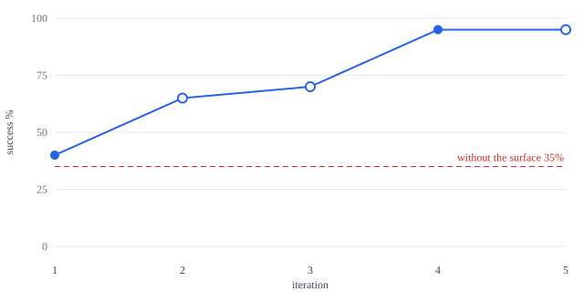

# Task success per iteration

| Iteration | Aspect | Note | Success | Kept |
|---|---|---|---|---|
| 1 | baseline |  | 40.0% | yes |
| 2 | descriptions | descriptions tell the model to read the record itself, how day numbers map, and to batch merges | 65.0% | no |
| 3 | descriptions | descriptions v2: reads answer questions, day mapping, batching; changes only on request | 70.0% | no |
| 4 | descriptions | descriptions v3: show-me means focus_day; stepwise recipe for marking a named visit; findings are candidates | 95.0% | yes |
| 5 | descriptions | final surface re-run with both arms and the same model; no change since iteration 4 | 95.0% | no |
